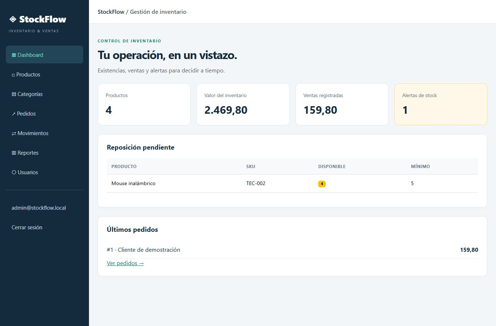

# StockFlow

[](https://github.com/jpsanoli2/StockFlow/actions/workflows/ci.yml)

Sistema de inventario y ventas para portfolio, construido con **Blazor Web App Interactive Server, ASP.NET Core 10, EF Core 10 y SQL Server**. Autenticación con ASP.NET Core Identity y autorización por roles tanto en las pantallas como en los servicios.

## Qué incluye

- Dashboard con cantidad de productos, inventario valorizado, ventas y alertas de reposición.
- CRUD de productos y categorías, búsqueda, SKU único y validación de datos.
- Pedidos con múltiples líneas, agrupación de productos repetidos, precios históricos y detalle de venta.
- Descuento de stock, pedido y movimientos confirmados en una **misma transacción SQL Serializable**. Un fallo revierte todos los cambios.
- Protección de concurrencia con `rowversion`, restricciones SQL y orden consistente de lectura de productos.
- Identificador de solicitud único para evitar duplicar pedidos al reenviar.
- Entradas y ajustes de stock con saldo, motivo, fecha UTC y usuario responsable.
- Reportes de ventas por fechas, ticket promedio, ventas diarias, productos más vendidos e inventario valorizado.
- Exportación CSV con protección frente a fórmulas en campos ingresados por usuarios.
- Administración de roles, registro, ingreso, cierre de sesión y gestión de cuenta de Identity.
- Migraciones versionadas, datos de demostración, tests xUnit contra SQL Server real y workflow de GitHub Actions.



## Inicio rápido en Windows

Requisitos: SDK **.NET 10** y **SQL Server Express LocalDB**. LocalDB se instala con el componente de almacenamiento de datos de Visual Studio o SQL Server Express. No hace falta Node.js.

Cloná el repositorio y entrá a la carpeta:

```powershell
git clone https://github.com/jpsanoli2/StockFlow.git
cd StockFlow
```

Desde la carpeta que contiene `StockFlow.sln`:

```powershell
dotnet restore
dotnet build
dotnet run --project src/StockFlow.Web --launch-profile http
```

Abrir **http://localhost:5133**. En Development el primer arranque crea la base `StockFlow`, aplica las migraciones, crea los roles y carga tres productos de demostración. Los siguientes arranques conservan los datos.

Cuenta de demostración, exclusivamente para uso local:

| Email | Contraseña | Rol |
|---|---|---|
| admin@stockflow.local | StockFlow!2026 | Admin |

Para HTTPS:

```powershell
dotnet dev-certs https --trust
dotnet run --project src/StockFlow.Web --launch-profile https
```

Abrir https://localhost:7070. Si no querés instalar un certificado local, usá el perfil `http` anterior.

## SQL Server en Linux, macOS o una instancia remota

LocalDB sólo funciona en Windows. En otras plataformas usá SQL Server accesible por red, Azure SQL o Docker. El servidor requiere una instancia con permisos para crear la base y aplicar migraciones; los tests requieren permiso para crear y eliminar sus propias bases aisladas.

Ejemplo PowerShell con el contenedor incluido (requiere Docker y aceptar la licencia de SQL Server):

```powershell
$env:STOCKFLOW_SQL_PASSWORD = 'UnaClaveLocal!2026'
docker compose up -d sql
# Esperar a que SQL Server esté listo para aceptar conexiones.
$env:ConnectionStrings__DefaultConnection = "Server=localhost,1433;Database=StockFlow;User Id=sa;Password=$env:STOCKFLOW_SQL_PASSWORD;TrustServerCertificate=True"
dotnet run --project src/StockFlow.Web --launch-profile http
```

En bash:

```bash
export STOCKFLOW_SQL_PASSWORD='UnaClaveLocal!2026'
docker compose up -d sql
export ConnectionStrings__DefaultConnection="Server=localhost,1433;Database=StockFlow;User Id=sa;Password=${STOCKFLOW_SQL_PASSWORD};TrustServerCertificate=True"
dotnet run --project src/StockFlow.Web --launch-profile http
```

El contenedor usa un volumen persistente. La contraseña de ejemplo es local; para una instalación real elegí un secreto propio y un usuario SQL con los permisos necesarios.

## Roles y flujo de demostración

| Operación | Viewer | Operator | Admin |
|---|---|---|---|
| Dashboard, catálogo, pedidos, movimientos y reportes | Sí | Sí | Sí |
| Crear/editar productos | No | Sí | Sí |
| Registrar pedidos y movimientos | No | Sí | Sí |
| Eliminar productos sin historial | No | No | Sí |
| Crear, editar y eliminar categorías | No | No | Sí |
| Administrar roles | No | No | Sí |

1. Ingresar como administrador. Revisar el mouse con stock bajo en el dashboard.
2. Crear una categoría y un producto. El stock inicial genera un movimiento.
3. Agregar productos a un pedido y confirmarlo. Consultar el detalle y el movimiento de venta.
4. Intentar vender más unidades de las disponibles: la operación se rechaza sin cambios parciales.
5. Registrar una reposición desde Movimientos y exportar los reportes.
6. Registrar otra cuenta: recibe `Viewer`. El administrador puede darle `Operator` desde Usuarios.

Los permisos actuales y el security stamp se consultan en el servidor en cada operación de negocio. Un cambio de rol invalida las operaciones de la sesión anterior; el usuario debe cerrar sesión y volver a ingresar para actualizar también los menús. Nadie puede cambiar su propio rol desde Usuarios.

El stock de un producto existente se modifica exclusivamente desde movimientos o pedidos. No se permite borrar productos con historial ni categorías con productos, para preservar trazabilidad. Las ventas confirmadas son inmutables: este alcance no incluye anulaciones, devoluciones, impuestos ni múltiples monedas. Los importes usan `decimal` con dos decimales y las fechas se guardan en UTC. La interfaz principal está en español; las pantallas avanzadas de gestión de cuenta mantienen parte de la UI oficial de Identity.

## Migraciones

Las migraciones de Identity y StockFlow están en `src/StockFlow.Web/Data/Migrations`. No se usa `EnsureCreated` ni es necesario generar migraciones para empezar.

```powershell
dotnet tool restore
dotnet ef database update --project src/StockFlow.Web
dotnet ef migrations has-pending-model-changes --project src/StockFlow.Web
```

Para un cambio futuro del modelo:

```powershell
dotnet ef migrations add NombreDelCambio --project src/StockFlow.Web --output-dir Data/Migrations
dotnet ef database update --project src/StockFlow.Web
```

Para generar un script SQL revisable antes de desplegar:

```powershell
dotnet ef migrations script --idempotent --project src/StockFlow.Web --output stockflow.sql
```

## Compilación y tests

```powershell
dotnet build StockFlow.sln -c Release
dotnet test StockFlow.sln -c Release --logger trx
```

Los tests de integración usan SQL Server, incluyendo sus transacciones, claves foráneas y `rowversion`; no usan EF InMemory. Por defecto se conectan a LocalDB. Cada ejecución crea una base `StockFlowTests_<guid>` y elimina sólo esa base al finalizar. No tocan `StockFlow`.

Para otra instancia:

```powershell
$env:STOCKFLOW_TEST_SQL = 'Server=localhost,1433;User Id=sa;Password=UnaClaveLocal!2026;TrustServerCertificate=True'
dotnet test -c Release
```

Sólo tests independientes de SQL:

```powershell
dotnet test --filter FullyQualifiedName~CsvTests
```

El workflow `.github/workflows/ci.yml` restaura, compila en Release y corre los tests con SQL Server en GitHub Actions. Ver [docs/VERIFICACION.md](docs/VERIFICACION.md) para los resultados de la entrega.

## Estructura y decisiones

```text
src/StockFlow.Web/
  Components/Pages/       Dashboard, catálogo, pedidos, movimientos, reportes y usuarios
  Components/Account/     UI y endpoints de Identity
  Domain/                Entidades, contratos de pedido y errores de negocio
  Data/                  DbContext, migraciones y seed
  Services/              Inventario, permisos, administración de usuarios y CSV
  wwwroot/               Estilos y descarga CSV
tests/StockFlow.Tests/    Tests unitarios y de integración SQL
```

Los componentes usan un contexto por operación mediante `IDbContextFactory`, para no compartir un DbContext durante un circuito Blazor. Las reglas de negocio y la autorización están en los servicios; ocultar un botón no concede ni revoca permisos. Las operaciones de stock son transaccionales, los precios se copian al pedido y los índices únicos protegen SKU y solicitudes.

## Configuración y despliegue

La conexión local está en `appsettings.json`. Las variables de entorno `ConnectionStrings__DefaultConnection`, `Seed__AdminEmail` y `Seed__AdminPassword` permiten sustituirla sin subir secretos a GitHub. También podés usar `dotnet user-secrets` durante desarrollo.

En Production **no se ejecutan migraciones ni se crean cuentas automáticamente al iniciar**. Para inicializar una instalación vacía, configurá una conexión válida y la contraseña del administrador por variables de entorno y ejecutá una vez:

```powershell
$env:ASPNETCORE_ENVIRONMENT = 'Production'
$env:Seed__AdminEmail = 'admin@tu-dominio.com'
$env:Seed__AdminPassword = 'ReemplazarPorUnSecretoPropio!'
dotnet run --project src/StockFlow.Web --no-launch-profile -- --initialize
dotnet publish src/StockFlow.Web -c Release -o artifacts/publish
```

`--initialize` aplica migraciones y crea roles, además del administrador si se configuró su contraseña. Es idempotente y no cambia la contraseña de una cuenta existente. Usá permisos de migración sólo para este paso; la cuenta de ejecución debe tener permisos limitados. En despliegue configurá HTTPS y un almacenamiento persistente de Data Protection. Para varias instancias de Interactive Server se requieren afinidad de sesión y configuración adecuada de SignalR.

El `Dockerfile` permite publicar la aplicación como contenedor; `compose.yaml` proporciona solamente SQL Server para desarrollo. Docker no es necesario para el inicio rápido en Windows.

Identity incluye componentes de recuperación por correo de la plantilla oficial, pero esta entrega tiene `IdentityNoOpEmailSender`: **no envía correos reales**. El acceso local no exige confirmación por email. Antes de habilitar recuperación por email en un despliegue, reemplazá ese servicio por un proveedor real y configurá la política de confirmación que necesites. No se incluyen integraciones externas ni secretos de correo.

## Estado del proyecto

Proyecto de portfolio con datos de demostración. La validación local de la entrega original aprobó 30 tests; los detalles están en [docs/VERIFICACION.md](docs/VERIFICACION.md). El estado del workflow publicado puede consultarse en [GitHub Actions](https://github.com/jpsanoli2/StockFlow/actions).

Descripción sugerida para tu CV: «Desarrollé un sistema de inventario y ventas con Blazor Interactive Server, ASP.NET Core, EF Core y SQL Server; implementé Identity con roles, operaciones de stock transaccionales, trazabilidad, reportes CSV y tests de integración con CI».

Referencias técnicas: [Blazor e Identity](https://learn.microsoft.com/aspnet/core/blazor/security/?view=aspnetcore-10.0), [EF Core en Blazor](https://learn.microsoft.com/aspnet/core/blazor/blazor-ef-core?view=aspnetcore-10.0).
